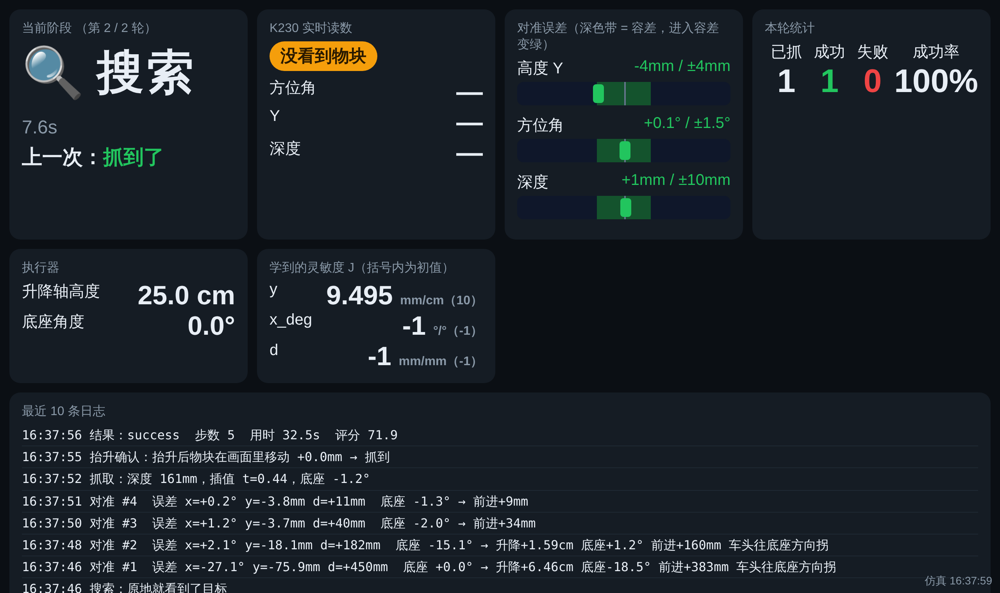

# 任务 16 报告：比赛演示模式 + 实时网页看板

> 分支 `cloud/16-demo-dashboard`。**全部只在云端用仿真和离线测试验证，没有在真机上运行过**。
> 真机上第一次用之前，请先按第 5 节做一次"空跑"检查。

## 0 结论

- 新增 `grasp/dashboard.py`（网页看板）、`grasp/demo.py`（演示模式）、`grasp/test_demo.py`（离线测试 36 项）
- `main.py` 加了 `--dashboard`（**默认关**）；`config.py` 加了 3 个参数（默认都关），并加进 `CALIB_KEYS` 白名单
- **`task.py` 没有改**；抓取逻辑全部复用 `main.open_devices / preflight / attach_task` 和 `GraspTask.run_once`
- 验收：`python3 selftest.py` 143 项全部通过；`python3 test_demo.py` 36 项全部通过；`python3 demo.py --sim 3` 能跑
- 仿真回归 `main.py --sim 100`（种子 1）改前改后完全一样：真实抓到 88/100，平均对准 4.3 步，平均 60.6s
- 换行保持原样：`config.py`、`README.md` 仍是 CRLF；`main.py` 仍是 LF；新文件用 LF（和 `recorder.py` 一样）

## 1 改了哪些文件

| 文件 | 改动 |
|---|---|
| `grasp/dashboard.py`（新） | `TaskMonitor`：挂在任务上收集状态；`DashboardServer`：`http.server` + SSE；网页（内嵌在文件里） |
| `grasp/demo.py`（新） | 演示模式：一轮接一轮、大号状态行、统计、语音播报、Ctrl+C 安全停止；`--sim N` 仿真 |
| `grasp/test_demo.py`（新） | 离线测试，不改 `selftest.py` |
| `grasp/main.py` | `get_dashboard()`；`attach_task(..., dashboard=False, monitor=None)` 两个新参数（默认不挂，`bench.py` 的调用不受影响）；`run_real` 和命令行加 `--dashboard` |
| `grasp/config.py` | `DASHBOARD_PORT = 8080`、`DEMO_AUTO_INTERVAL_S = None`、`DEMO_TTS_CMD = None`，都加进白名单 |
| `raspberrypi/README.md` | 文件表里加一行 |

### 怎么挂上去的（不改 task.py 的行为）

和 `recorder.py` 一样，在 `attach_task` 里挂：
- 升降轴外面包一层很薄的代理，只记下 `move_to / move_by / wait_move` 返回的高度（仿真的 `SimLift` 没有 `pos`；真机 `Lift.pos` 直接读）。代理在记录器外层、单步代理里层。
- 在 task 实例上包住 `search / align / grasp / _observe_check / _lift_check / place / release_and_back_off / measure / say / run_once`：先通知看板"进入某阶段"，再**原样调用、原样返回**。
- 看板线程只读不写：K230 读数直接读 `K230.frames`（加 `cam._lock`），**不会往任何串口发命令**（比如不会发 `P` 查询升降轴）。
- 测试 1 验证了：同一个仿真种子，挂 / 不挂看板的每一次抓取结果逐项相同（有底盘、无底盘各 4 次）；不加 `--dashboard` 时 task 上什么都没挂、设备也没被包。

阶段的判定：进入 `search` = 搜索，`align` = 对准，`grasp` = 伸出，伸出后第一次测量或 `_observe_check` = 确认，`place` = 放置，`release_and_back_off` = 重试，`run_once` 返回 = 完成。

## 2 网页看板

### 截图（仿真，`demo.py --sim 3 --dashboard --realtime 3`，用 Playwright 截的）

- 电脑宽屏：[`16_看板_电脑.png`](16_看板_电脑.png)（第 2 轮刚开始搜索，上一轮"抓到了"）
- 手机竖屏 + 画中画模式 `?pip=1`：[`16_看板_手机画中画.png`](16_看板_手机画中画.png)（对准中，三条误差条都还是橙色）



页面内容（深色背景、大字号、中文）：

| 卡片 | 内容 |
|---|---|
| 当前阶段 | 图标 + 大字阶段名（待机 / 搜索 / 对准 / 伸出 / 确认 / 放置 / 重试 / 完成 / 已停止）+ 这个阶段已经用了几秒、第几轮；上一次的结果（绿 = 抓到了，红 = 失败原因） |
| K230 实时读数 | 状态徽章：绿"看到物块"、黄"心跳（没看到物块）"、红"没有数据（检查 K230）"；方位角、Y、深度 |
| 对准误差 | 每个轴一条：中间竖线 = 0，深色带 = 容差 `TOL`，滑块 = 当前误差（满刻度 = 4 倍容差）；进入容差滑块和数字变绿 |
| 本轮统计 | 已抓 / 成功 / 失败 / 成功率 |
| 执行器 | 升降轴高度（cm）、底座角度（°） |
| 学到的灵敏度 J | 每个轴当前值（括号内为初值） |
| 最近 10 条日志 | task 打印的每一行（最新的在最上面） |

接口：`/` 页面；`/api/state` 一次 JSON；`/events` SSE（状态变化时推、不变也每秒推一次；浏览器断了自动重连）。

### 手机怎么打开

1. 手机和树莓派连**同一个 Wi-Fi / 热点**（比赛现场建议用自己的手机热点，树莓派也连这个热点）
2. 树莓派上运行带 `--dashboard` 的命令，终端会打印地址，例如
   `网页看板：手机 / 电脑浏览器打开 http://192.168.43.120:8080   （画中画小窗口加 ?pip=1）`
3. 手机浏览器打开这个地址。打不开时：
   - 在树莓派上 `hostname -I` 看 IP
   - 防火墙：`sudo ufw status`，如果开着就 `sudo ufw allow 8080/tcp`
   - 端口被占用：`demo.py --port 8081`，或在 `calib.json` 里写 `"DASHBOARD_PORT": 8081`
   - 有的校园网 / 公共 Wi-Fi 禁止设备互访（AP 隔离），换手机热点
4. 想在电脑上先看效果（不需要硬件）：`python3 demo.py --sim 3 --dashboard --realtime 1`，浏览器打开 `http://127.0.0.1:8080`

## 3 演示模式 demo.py

```bash
cd raspberrypi/grasp
python3 demo.py --no-chassis --rounds 5                       # 每轮之间等操作员把物块放回去、按回车（q 退出）
python3 demo.py --no-chassis --rounds 10 --auto 3             # 放了多个物块：每轮之间自动等 3 秒
python3 demo.py --no-chassis --rounds 5 --dashboard --record  # 同时开看板、记录论文数据
python3 demo.py --sim 3                                       # 仿真
```

其它参数：`--rounds 0` 一直抓到 Ctrl+C；`--step` 单步；`--force` 跳过启动检查；`--verbose` 终端里也打印详细过程（默认只写到 `logs/demo_*.log`，看板上也有）；`--plain` 不用颜色；`--port` 看板端口。

终端输出（`demo.py --sim 4 --no-chassis --seed 3` 的一段）：

```
━━━━━━━━━━━━━━ 第 2 / 4 轮 ━━━━━━━━━━━━━━
  🔍  搜索    28.7s   发现物块  深度 144mm  方位 +14.2°
  🎯  对准     2.1s   2 步，误差进入容差
  🦾  伸出     3.6s   深度 146mm
  👀  确认     4.0s   ✅ 抓到了
  📦  放置     3.7s
  ✅  抓到了！   本轮用时 43.2s   累计 成功 2 / 2

━━━━━━━━━━━━━━━━ 本次统计 ━━━━━━━━━━━━━━━━
  共 4 轮   成功 4   失败 0   成功率 100%
  平均每轮 37.0s   成功的平均 37.0s（最快 23.2s）
  各阶段平均用时：搜索 22.0s  对准 2.2s  伸出 4.1s  确认 3.8s  放置 3.7s
  学到的灵敏度 J：y=9.432  x_deg=-0.855
  仿真真实抓到 4 / 4
```

- 每个阶段**结束时**打一行（图标、阶段名、用时、说明），成功绿色、失败红色
- **Ctrl+C**：任何时候按下，先单独调用升降轴 `stop()`（发 `E` 急停）和底盘 `stop()`，再 `close_devices` 关串口，然后照样打印统计。测试 5 用假设备验证了这两个 `stop()` 都被调用
- 手柄接管、设备错误的处理和 `main.run_real` 一样（设备错误重开串口再来；连续 3 次就停）
- **语音播报**：`config.DEMO_TTS_CMD`（默认 `None` 不播报）。在"发现物块 / 抓到了 / 没抓到，重试"时播报，后台线程执行不阻塞抓取，跟不上就丢掉。命令里的 `{text}` 换成要说的话：
  ```json
  "DEMO_TTS_CMD": "espeak-ng -v zh -s 160 {text}"
  ```
  （写进树莓派的 `calib.json`；树莓派上要先 `sudo apt install espeak-ng`，**没在真机上试过中文发音效果**）。命令执行失败会提示一次，之后不再播报。

## 4 录屏建议

1. **画中画**：手机或第二台电脑打开 `http://<IP>:8080/?pip=1`（只有阶段、K230、误差条、计数，竖屏正好），用手机录屏；主画面拍机械臂。剪辑时把看板放在角落，对应拍摄清单 ③④
2. 电脑全屏录 `http://<IP>:8080`（不加 `pip`）可以连日志、J 一起录，适合答辩现场投屏
3. 终端画面：把终端字号调到 24 以上、深色主题，`demo.py` 默认就只显示大号状态行；需要"对准 #1 误差 …"这种细节（拍摄清单 ③）就加 `--verbose`
4. 连续抓取（拍摄清单 ④）：`--rounds 10 --auto 3` + 多个物块，一镜到底，后期加速；看板上的"已抓 / 成功"计数就是字幕
5. 录之前先 `--sim 3 --dashboard --realtime 1` 在电脑上排练一次画面构图
6. 看板的时间是树莓派的时间；页面右下角有"实时 / 仿真 + 时间"，录屏时能看出画面是实时的

## 5 真机第一次使用前（未验证项）

- [ ] `python3 demo.py --no-chassis --rounds 1 --dashboard --step`：单步跑一轮，看板阶段是否跟着变、K230 徽章是否在"看到 / 心跳"之间正确切换
- [ ] 看板开着时抓取速度有没有变慢（看板线程每 0.3s 读一次 K230 帧队列，理论上可以忽略）
- [ ] 手机打开后在对准阶段看误差条是否和终端里的"对准 #n 误差"一致
- [ ] 中途按 Ctrl+C，确认升降轴立即停、程序打印统计后退出
- [ ] TTS：先在终端单独试 `espeak-ng -v zh 抓到了`，能出声再写进 `calib.json`

## 6 已知限制

- 仿真的 `SimCam` 没有心跳，所以仿真里 K230 徽章只有"看到物块 / 没看到物块"两种；真机才有"心跳 / 没有数据"
- 看板没有任何控制按钮（只看），也没有密码；同一局域网的人都能看。比赛现场用自己的热点
- 多个浏览器同时打开每个占一个线程，十几个以内没问题
- 有底盘的演示（`demo.py` 不加 `--no-chassis`）和 `main.py` 一样依赖底盘联调结果，底盘固件没有串口超时停车（任务 03）——Ctrl+C 时会发停车，但程序崩溃 / 断电时底盘不会自己停
